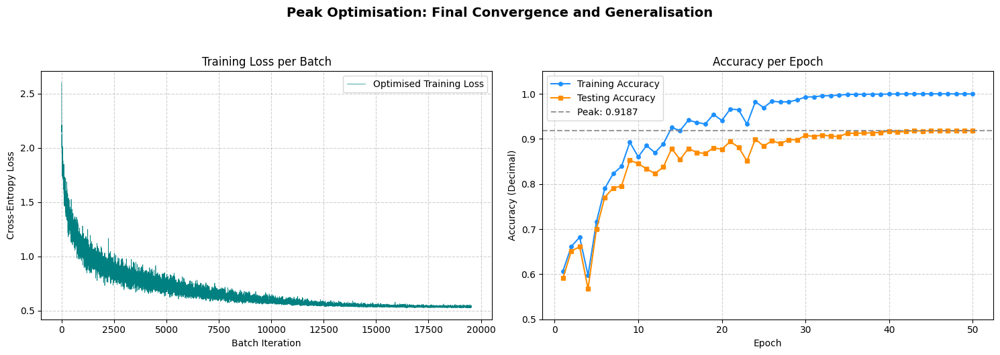

# CIFAR-10 image classification with a multi-branch CNN (PyTorch)

A convolutional network built from scratch in PyTorch. Its blocks run several convolution branches in parallel and **learn, per image, how much weight to give each branch**. I took it from 34% to **91.8% test accuracy** in five controlled stages, changing one thing at a time and measuring the effect.

`Python` · `PyTorch` · `torchvision` · `CUDA (Colab T4)` · `matplotlib`

## The architecture

The coursework fixed the building block:

- **Intermediate block:** *L* independent 3×3 convolution branches see the same input. A small linear layer maps the input's per-channel means to a coefficient vector **a**. The block outputs Σ *a*ₗ · branchₗ(*x*), so the mixing weights change from image to image.
- **Output block:** global average pooling, then a linear layer to the 10 class logits.

I implemented both blocks and tested each one on its own (output shapes, branch independence). I also initialised the coefficient layer with zero weights and a bias of 1, so every branch starts with equal weight and no gradient dies at the start of training.

## Five stages, one change at a time

| Stage | What changed | Epochs | Best test acc. |
|---|---|---|---|
| 1. Linear baseline | 3 blocks (3→16→32→64 channels), no activations | 10 | 34.1% |
| 2. Deep non-linear | ReLU, 6 blocks, max-pooling 32→16→8 | 15 | 78.7% |
| 3. Augmentation | Random crop (pad 4) + horizontal flip, CIFAR-10 normalisation | 15 | 82.3% |
| 4. Batch normalisation | Conv → BatchNorm → ReLU in every branch, conv bias removed | 20 | 86.8% |
| 5. Final training setup | Dropout 0.4, label smoothing 0.1, AdamW (wd 1e-4), cosine annealing | 50 | **91.9%** (91.8% at the final epoch) |

What each stage showed:

- **Stage 1** plateaus at about 34%. Without non-linearities, the stacked blocks collapse into a single linear map.
- **Stage 2** reaches 98% training accuracy but only 78% on test. The model is memorising the training set.
- **Stages 3 and 4** narrow that gap. Augmentation makes memorising harder, and batch normalisation stabilises training.
- **Stage 5** stacks four regularisation choices and trains for 50 epochs on a cosine schedule. The learning rate decays to zero, so the test curve flattens rather than oscillating.



Final hyperparameters: batch size 128, AdamW (lr 1e-3, weight decay 1e-4), cosine annealing over 50 epochs, dropout 0.4, cross-entropy with label smoothing 0.1, seed 42.

## Caveat on the numbers

The coursework reports accuracy on the CIFAR-10 test set after every epoch, and each stage was judged on that test score. **There was no separate validation set.** So "best test accuracy" is slightly optimistic. The final-epoch figure (91.8%) is the fairer number, because the 50-epoch schedule was fixed in advance. To fix this properly, I'd hold out 5,000 training images for validation and only score the test set once at the end.

## Running it

The notebook runs top to bottom on a GPU; I used a Google Colab T4. CIFAR-10 downloads automatically through `torchvision`.

```bash
pip install -r requirements.txt
jupyter notebook cifar10_multibranch_cnn.ipynb
```

Each stage takes about 1 minute per epoch on a T4. The final 50-epoch run takes about 50 minutes.

## Credit

This was Task 1 of a three-person group coursework (Neural Networks and Deep Learning, QMUL, 2026). **I built Task 1 end to end:** data loading, both blocks, every stage and experiment, the debugging and the visualisations. My teammate **Uhunoma Osemwengie** researched the literature and suggested label smoothing, AdamW and cosine annealing for the final stage, and also reviewed the work. The group's Task 2 (ECG arrhythmia classification, by Shaden Althunayan) is not part of this repository.

References: He et al. (2019), *Bag of Tricks for Image Classification with Convolutional Neural Networks*, CVPR. Loshchilov & Hutter (2019), *Decoupled Weight Decay Regularization*, ICLR.
